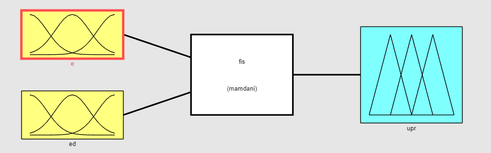
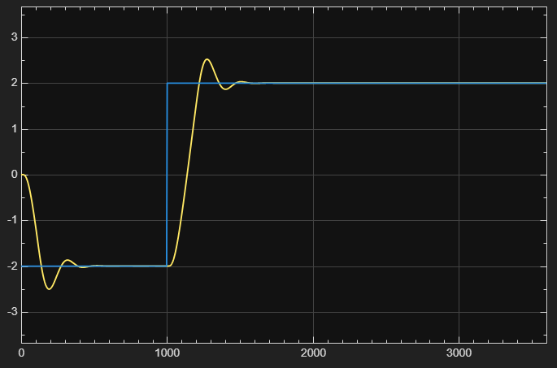
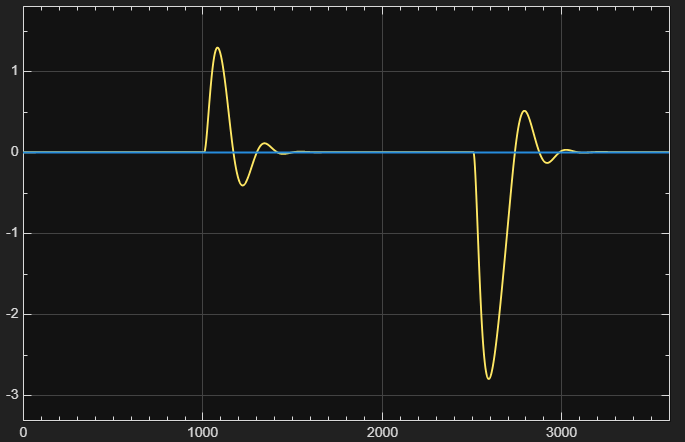

# Mamdani Fuzzy Control in MATLAB and Simulink

This project implements intuitive Mamdani fuzzy controllers for reference tracking and input-disturbance rejection. The controller and both closed-loop systems are modelled in MATLAB and Simulink.

## Controlled plant

$$
G(s) = \frac{0.0125}{(s + 0.04)^2}e^{-10s}
$$

The reference range is $r \in [-2, 2]$, while the control signal is limited to $u \in [-0.5, 0.5]$.

## Fuzzy controller

- Mamdani inference system
- Two inputs: control error `e` and error derivative `ed`
- One output: control signal `upr`
- Three membership functions for each input
- Five output membership functions
- Five inference rules
- Minimum implication
- Maximum aggregation
- Centroid defuzzification



## Simulink models

### Reference tracking

`Upravljac.slx` applies a step change from the minimum to the maximum reference value. The controlled variable follows the reference after a short oscillatory transient while the control signal remains within its specified limits.



### Disturbance rejection

`Potiskivanje.slx` tests positive and negative input disturbances while the reference remains at zero. The controller compensates for each disturbance and returns the controlled variable close to its reference.



## Project structure

```text
.
|-- fis.fis
|-- Upravljac.slx
|-- Potiskivanje.slx
|-- assets/
|   |-- fis-overview.png
|   |-- reference-tracking-response.png
|   `-- disturbance-rejection-response.png
`-- FUZZY Projekat.docx
```

## Requirements

- MATLAB
- Simulink
- Fuzzy Logic Toolbox

## Usage

1. Open MATLAB in the project directory.
2. Make sure `fis.fis` is available in the current folder or on the MATLAB path.
3. Open `Upravljac.slx` for reference tracking or `Potiskivanje.slx` for disturbance rejection.
4. Run the selected model and inspect the connected scopes.

## Report

The complete Serbian-language project report is available in [FUZZY Projekat.docx](FUZZY%20Projekat.docx).

## License

No software license has been added to this project.
